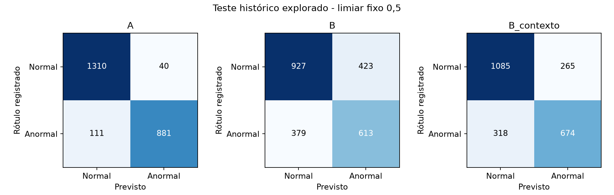
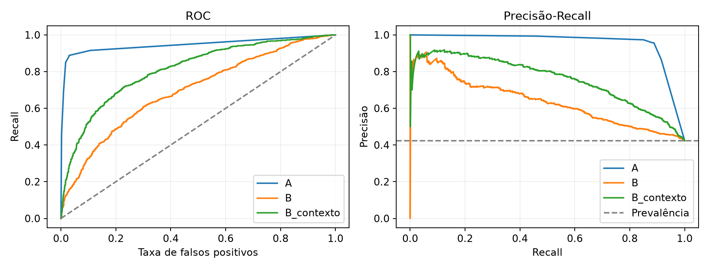

# A2 - Processo completo do KDD

Grupo 3 - Mineração de Dados, UFG, 2026/2. Antônio Henrique Queiroz Villar Lopes, João Vitor Fernandes Ferreira, Mateus Nery Bailão e Pedro Augusto Ferreira Matos.

## 1. Objetivo e conhecimento procurado

O estudo procura padrões que distinguem Normal de Anormal no rótulo registrado da base UCMF. A tarefa é classificação supervisionada: há exemplos com uma resposta binária disponível. Não se presume um diagnóstico independente nem se anuncia capacidade de triagem antes do exame. Agrupamento, regressão e associação seriam outras tarefas; não substituem essa pergunta.

A A2 reúne o processo inteiro do KDD. Reutilizamos a A1 como ponto de partida, criticamos e melhoramos sua preparação, executamos mineração, avaliação, interpretação e uma aplicação acadêmica. A A1 avaliada continua sendo a versão já entregue; os documentos históricos permanecem idênticos. A descrição formal da A2 ainda poderá acrescentar exigências de apresentação, sem tornar pendente o processo técnico executado aqui.

## 2. Seleção, população e entendimento dos dados

A entrada possui 12.873 linhas e 21 variáveis. Conservamos todas as linhas, inclusive equivalências candidatas e registros sem alvo. Normal=0 e Anormal=1; são 6.744 Normais, 4.960 Anormais e 1.169 sem rótulo utilizável. A classificação usa apenas os 11.704 conhecidos antes da quarentena. Não imputamos y. ID único não estabelece paciente único.

A preparação mantém 9.361 registros de desenvolvimento, 2.342 no teste histórico e uma quarentena anterior ao ajuste. A união transitiva dos grupos exigiu 0 quarentenas adicionais. Modelos dos cenários usam os mesmos registros e partições. As equivalências são candidatas; a dependência real entre atendimentos pode continuar maior que a identificada.

| Papel | Variáveis |
| --- | --- |
| Medidas quantitativas | Peso, Altura, IMC, IDADE, PAS, PAD, FC |
| Nominais de exame/contexto | PULSOS, PPA, B2, SOPRO, HDA1, HDA2, SEXO, MOTIVO1, MOTIVO2 |
| Rastreio e fonte de derivação | ID, Atendimento, DN |
| Administrativa fora de X | Convenio |
| Alvo separado de X | NORMAL X ANORMAL |

## 3. Exploração e crítica da qualidade

Exploramos tipos, escalas, cobertura, tendência central, dispersão, forma das distribuições, correlação e associações bivariadas. Essas estatísticas usam medidas disponíveis antes da imputação. Faltante, zero-sentinela, inconsistência e outlier têm significados distintos; reduzir desvio ou aumentar correlação não prova que uma limpeza ficou correta.

A idade recebida acompanha dias/352 a até 0,01 ano em 11.191 casos comparáveis, com 11.120 coincidências exatas após arredondamento. Isso sustenta a crítica aritmética, sem revelar a fórmula original. A revisão resolve 11.208 idades relativas por pares de datas compatíveis sob o recorte pediátrico, sem escolher século absoluto. Dezoito idades literais são aproveitadas e 1.647 permanecem indisponíveis.

| Medida | Disponíveis | Ausentes % | Mediana | DP |
| --- | --- | --- | --- | --- |
| Peso | 9.929 | 22,9 | 16,0 | 16,4 |
| Altura | 8.395 | 34,8 | 100,0 | 35,4 |
| IMC | 8.023 | 37,7 | 16,7 | 3,8 |
| IDADE | 11.226 | 12,8 | 3,9 | 4,5 |
| PA SISTOLICA | 5.140 | 60,1 | 100,0 | 11,6 |
| PA DIASTOLICA | 5.132 | 60,1 | 60,0 | 9,1 |
| FC | 10.995 | 14,6 | 92,0 | 18,2 |

## 4. Limpeza e criação de atributos: decisão por evidência

Padronizamos Unicode, espaços e grafias documentadas. Sentinelas são específicas da coluna: SOPRO Ausente é achado registrado e não campo vazio. Prefixos de MOTIVO2 não substituem a descrição completa. Alvos duvidosos não são inferidos. Datas exigem interpretação completa da célula; texto residual e ano ambíguo não são descartados para fabricar certeza.

A idade relativa usa aniversários de calendário e pares candidatos com 0 <= idade <20, tolerando até um dia de divergência na duração e guardando intervalo e hipótese. IMC = Peso/(Altura/100)^2 usa apenas pais observados operacionalmente utilizáveis; quando necessário, o valor histórico permanece com origem. Não recalculamos IMC depois de imputar seus pais.

Envelopes históricos são alertas. Preservamos pesos acima do antigo teto e frequências cardíacas positivas potencialmente reais. A guarda conjunta de razão antropométrica fora de 5-100 mascara o trio na política principal, sem escolher o campo errado ou apagar idade. Essa guarda e os demais cortes restantes são hipóteses de curadoria, não faixas clínicas. Foram mascarados 16 valores de Peso, 18 de Altura, 14 de IMC, 3 de PAS, 1 de PAD e 8 de FC. Uma alternativa com suspeitos preservados foi efetivamente testada.

O registro completo descreve as 21 variáveis, os formatos aceitos, sentinelas, condições, exceções, alternativas e incertezas. Valores brutos, candidatos e intervenções por célula ficam na proveniência local. Isso permite revisar uma decisão sem apagar a fonte.

## 5. Transformações e prevenção de vazamento

Comparamos medianas global, por idade e por idade/sexo por mascaramento artificial de 20% de medidas observadas, em cinco repetições apenas no desenvolvimento. Faixas fixas [0;0,25;0,5;1;2;5;10;15;20) precisam de 30 observados e têm fallback global. O diagnóstico favoreceu idade para Peso, Altura, FC e IMC; o IMC foi limítrofe. Isso não identifica o mecanismo das ausências reais.

Na mineração, a imputação global e a condicional por idade voltam a competir dentro de cada treino de fold. Assim, a escolha exploratória anterior não é tratada como um parâmetro já validado. Vocabulários, medianas, médias e desvios também são ajustados em cada treino. A matriz pronta de desenvolvimento não foi usada para selecionar modelos.

Categorias nominais usam one-hot, com estados separados para ausência e categoria inédita. Sete indicadores distinguem imputação de medida disponível. Z-score usa média e DP do treino (ddof=0); log1p é alternativa somente para Peso antes de padronizar. Bits continuam 0/1. Árvores usam unidades originais; logística compara a versão padronizada e a de log-Peso. A representação completa exportada possui 93 colunas, mas o vocabulário de cada fold pertence ao seu próprio treino.

## 6. Protocolo experimental e alternativas executadas

Cenário A inclui medidas, contexto e achados. B restringe-se às sete medidas e SEXO. B_contexto retira PULSOS, B2 e SOPRO de A, mantendo contexto cuja temporalidade não foi confirmada. São perguntas de disponibilidade diferentes: A não se anuncia como triagem antes do exame.

Comparamos 81 configurações em cada cenário por cinco folds estratificados e agrupados no desenvolvimento (seed 43). O critério é a média da acurácia balanceada; empates até 1e-12 seguem a ordem publicada. Sem custos confirmados de FP e FN, esse critério considera o recall das duas classes, enquanto precisão, recall e demais métricas continuam visíveis. Não é uma função de utilidade clínica.

A avaliação aninhada usa três folds externos e três internos, só no desenvolvimento (seeds 52 e 53+fold). A busca inteira se repete em cada treino externo. O resultado estima o procedimento de escolha condicionado às decisões de preparação já exploradas; não desfaz a exploração global anterior. Depois, todas as configurações finais são congeladas antes das métricas do teste histórico.

| Família | Configurações | Alternativas principais |
| --- | --- | --- |
| Controle majoritário | 1 | Referência sem informação de X |
| Árvore de decisão | 40 | Gini/entropia, profundidade3/6, folha20/50, poda alfa0,001/0,005, pesos e imputação |
| Regressão logística | 32 | C0,01/0,1/1/10, pesos, duas imputações e duas representações |
| Floresta aleatória | 8 | 150 árvores, profundidade 8/None, folha10, pesos e imputação |

## 7. Resultados atuais e significado da avaliação

Na busca principal, A escolheu árvore rasa com mediana global; B escolheu floresta de profundidade 8 com mediana global; B_contexto escolheu floresta com folha mínima 10 e mediana etária. O ganho de reconstrução da imputação etária não assegurou maior classificação. A teve muitas configurações empatadas em BA; a ordem publicada preferiu a árvore simples. A avaliação externa também escolheu logística em alguns folds de A e B_contexto, mostrando que o vencedor não é estável em todo subconjunto.

CV é a média dos folds usada na seleção. Nested é a acurácia balanceada das predições externas reunidas de modelos escolhidos dentro de cada treino externo. Teste é a avaliação secundária do conjunto histórico previamente explorado. Essas colunas não medem exatamente a mesma coisa; diferenças não demonstram melhora causal da limpeza nem desempenho em população nova.

| Cenário | Modelo | CV BA | Nested BA | Teste BA | Recall | Precisão | AP | Brier |
| --- | --- | --- | --- | --- | --- | --- | --- | --- |
| A | Árvore | 0,919 | 0,919 | 0,929 | 0,888 | 0,957 | 0,934 | 0,057 |
| B | Floresta | 0,634 | 0,631 | 0,652 | 0,618 | 0,592 | 0,637 | 0,220 |
| B_contexto | Floresta | 0,713 | 0,710 | 0,742 | 0,679 | 0,718 | 0,759 | 0,179 |

## 7.1 Desempenho de ajuste e complexidade

O desempenho no próprio desenvolvimento usado para ajuste é descritivo e tende a ser otimista. A diferença para CV ajuda a investigar sobreajuste; não substitui validação. A busca aninhada escolheu configurações distintas entre folds, portanto a tabela não estabelece um vencedor universal. Os componentes candidatos incluem 1 grupos de desenvolvimento com rótulos mistos; não corrigimos automaticamente esses rótulos.

| Cenário | BA no próprio treino | BA média CV | Atributos codificados |
| --- | --- | --- | --- |
| A | 0,919 | 0,919 | 93 |
| B | 0,663 | 0,634 | 18 |
| B_contexto | 0,753 | 0,713 | 72 |

## 7.2 Tipos de erro, incerteza e controles

Usamos limiar fixo p>=0,5. Recall = TP/(TP+FN), precisão = TP/(TP+FP), especificidade = TN/(TN+FP) e BA = (recall+especificidade)/2. F1 combina precisão/recall. ROC-AUC avalia ordenação de scores e AP resume precisão-recall pela sua definição; AP não é área trapezoidal. Brier descreve erro quadrático do score probabilístico, sem provar calibração clínica.

O controle majoritário tem BA=0,500. A regra fixa de SOPRO cobre 99,8% do teste e tem BA=0,920 nessa cobertura. Os modelos também foram calculados no mesmo subconjunto para comparação justa. O score binário dessa regra não é probabilidade calibrada.

Os intervalos percentis usam 500 reamostragens dos componentes candidatos, condicionadas ao modelo já ajustado. Não abrangem toda a incerteza da preparação e seleção. Subgrupos publicam suporte e erros; Wilson de recall é descritivo por linha e não corrige dependência de grupo. A instabilidade de um subgrupo pequeno não deve virar uma conclusão geral.

| Cenário | TN | FP | FN | TP | Especificidade | F1 | IC95 BA |
| --- | --- | --- | --- | --- | --- | --- | --- |
| A | 1310 | 40 | 111 | 881 | 0,970 | 0,921 | 0,918 a 0,939 |
| B | 927 | 423 | 379 | 613 | 0,687 | 0,605 | 0,632 a 0,674 |
| B_contexto | 1085 | 265 | 318 | 674 | 0,804 | 0,698 | 0,722 a 0,760 |

## 7.3 Curvas e limites de generalização

O limiar controla o compromisso entre erros. As curvas mostram possibilidades, mas nenhum ponto foi escolhido pelo teste. Formação do rótulo, identidade das pessoas, temporalidade dos achados e mudança de população ainda não estão confirmadas. Não executamos validação temporal com séculos ambíguos: uma janela histórica presumida não cria cronologia confiável.

## 8. Contestação das escolhas e testes de sensibilidade

Além da busca principal, contestamos o papel dos outliers, indicadores, atributos redundantes/esparsos e balanceamento. Sobreamostragem repete exemplos minoritários; subamostragem reduz majoritários; ambas ficam somente no treino e substituem o peso de classe, sem alterar validação ou teste. PCA95 é testada na melhor logística, com projeção aprendida em cada treino; deve ser comparada à mesma logística sem PCA, não atribuída à vencedora de outra família.

Em B, retirar IMC elevou BA média de 0,6341 para 0,6366: ganho de 0,0025, pequeno frente ao DP de 0,0092 dos folds da configuração principal. Isso é pista, não melhora confirmada. PCA reduziu BA em relação à mesma logística em todos os cenários: A: 0,9192 para 0,9174; B: 0,6186 para 0,6155; B_contexto: 0,7087 para 0,7071. Em A, várias intervenções não alteraram as decisões de classe: os achados de exame dominam esse resultado.

A tabela é exploratória e usa o desenvolvimento após a seleção principal. Um ganho pontual pede nova confirmação; não autoriza trocar o vencedor depois de observar o teste. Piorar também é resultado: informação rara, estimativa e redundância podem afetar cada cenário de modo diferente. Não forçamos toda técnica para acumular conceitos.

| Variante | A: CV BA | B: CV BA | B_contexto: CV BA |
| --- | --- | --- | --- |
| PCA95 (logística) | 0,917 | 0,616 | 0,707 |
| Principal | 0,919 | 0,634 | 0,713 |
| Sem HDA2 | 0,919 | - | 0,712 |
| Sem IMC | 0,919 | 0,637 | 0,710 |
| Sem IMC e HDA2 | 0,919 | 0,637 | 0,710 |
| Sem PPA | 0,919 | - | 0,711 |
| Sem indicadores | 0,919 | 0,627 | 0,711 |
| Sobreamostragem | 0,919 | 0,633 | 0,713 |
| Subamostragem | 0,919 | 0,629 | 0,711 |
| Suspeitos preservados | 0,919 | 0,635 | 0,711 |

## 9. Interpretação - cenário A

Na importância por permutação exploratória, os maiores efeitos foram SOPRO: queda 0,393; B2: queda 0,031; Peso: queda 0,000. O cálculo usa um fold de validação do desenvolvimento, não o treino desse modelo. A escolha de configuração já usou desenvolvimento, portanto a análise é pós-seleção. Permutar uma coluna pode quebrar correlações: queda de desempenho não é efeito causal de uma variável.

Para interpretar padrões legíveis, ajustamos também a melhor árvore por CV. As regras abaixo pertencem a essa árvore, que pode ser distinta do modelo vencedor. Suportes e frações são contagens reais no desenvolvimento, não probabilidades de nós ponderados por classe e não estimativas externas. As condições usam a representação após imputação. Um indicador nominal igual0 pode incluir campo vazio ou categoria inédita; não significa ausência clínica do achado.

| Regra da árvore | n desenvolvimento | Anormais observados |
| --- | --- | --- |
| SOPRO registrado como Ausente; B2 registrado como Normal; FC <= 115.5 | 5.136 | 7,7% |
| SOPRO diferente de Ausente (inclui falta/inédito); HDA 1 com registro; PA DIASTOLICA foi imputado | 1.765 | 98,3% |
| SOPRO diferente de Ausente (inclui falta/inédito); HDA 1 com registro; PA DIASTOLICA não foi imputado | 1.016 | 96,1% |

## 9. Interpretação - cenário B

Na importância por permutação exploratória, os maiores efeitos foram FC: queda 0,048; Peso: queda 0,024; IDADE: queda 0,013. O cálculo usa um fold de validação do desenvolvimento, não o treino desse modelo. A escolha de configuração já usou desenvolvimento, portanto a análise é pós-seleção. Permutar uma coluna pode quebrar correlações: queda de desempenho não é efeito causal de uma variável.

Para interpretar padrões legíveis, ajustamos também a melhor árvore por CV. As regras abaixo pertencem a essa árvore, que pode ser distinta do modelo vencedor. Suportes e frações são contagens reais no desenvolvimento, não probabilidades de nós ponderados por classe e não estimativas externas. As condições usam a representação após imputação. Um indicador nominal igual0 pode incluir campo vazio ou categoria inédita; não significa ausência clínica do achado.

| Regra da árvore | n desenvolvimento | Anormais observados |
| --- | --- | --- |
| Peso > 8.85; FC <= 98.5; SEXO com registro; Peso > 28.85 | 1.968 | 28,2% |
| Peso > 8.85; FC <= 98.5; SEXO com registro; Peso <= 28.85; FC <= 89.5 | 1.804 | 33,1% |
| Peso > 8.85; FC > 98.5 | 1.671 | 49,3% |

## 9. Interpretação - cenário B_contexto

Na importância por permutação exploratória, os maiores efeitos foram MOTIVO2: queda 0,053; MOTIVO1: queda 0,043; HDA 1: queda 0,013. O cálculo usa um fold de validação do desenvolvimento, não o treino desse modelo. A escolha de configuração já usou desenvolvimento, portanto a análise é pós-seleção. Permutar uma coluna pode quebrar correlações: queda de desempenho não é efeito causal de uma variável.

Para interpretar padrões legíveis, ajustamos também a melhor árvore por CV. As regras abaixo pertencem a essa árvore, que pode ser distinta do modelo vencedor. Suportes e frações são contagens reais no desenvolvimento, não probabilidades de nós ponderados por classe e não estimativas externas. As condições usam a representação após imputação. Um indicador nominal igual0 pode incluir campo vazio ou categoria inédita; não significa ausência clínica do achado.

| Regra da árvore | n desenvolvimento | Anormais observados |
| --- | --- | --- |
| MOTIVO2 diferente de 6 - sopro (inclui falta/inédito); MOTIVO2 diferente de 1 - cardiopatia congenica (inclui falta/inédito); FC <= 98.5; SEXO com registro; MOTIVO2 diferente de 5 - cirurgia (inclui falta/inédito); Peso > 21.15 | 1.540 | 23,1% |
| MOTIVO2 diferente de 6 - sopro (inclui falta/inédito); MOTIVO2 diferente de 1 - cardiopatia congenica (inclui falta/inédito); FC <= 98.5; SEXO com registro; MOTIVO2 diferente de 5 - cirurgia (inclui falta/inédito); Peso <= 21.15 | 1.377 | 33,6% |
| MOTIVO2 diferente de 6 - sopro (inclui falta/inédito); MOTIVO2 diferente de 1 - cardiopatia congenica (inclui falta/inédito); FC > 98.5; MOTIVO2 diferente de 5 - cirurgia (inclui falta/inédito); MOTIVO1 diferente de 2 - check-up (inclui falta/inédito); SEXO com registro | 1.108 | 46,6% |

## 10. Conhecimento obtido e aplicação responsável

A leitura integrada deve confrontar o desempenho com a informação disponível. A diferença entre A e B quantifica o valor preditivo de achados/contexto para o rótulo registrado, sem provar circularidade nem independência diagnóstica. Se um modelo rico apenas reproduz um exame que ajudou a formar o alvo, sua pontuação não demonstra capacidade de antecipar o diagnóstico. As medidas sozinhas precisam ser julgadas por seus próprios erros e incertezas.

A primeira aplicação, exigindo apenas um campo disponível, revelou um problema: A atribuía score a 430 registros sem alvo, embora muitos padrões de ausência tivessem suporte inexistente ou muito baixo no desenvolvimento. Rejeitamos essa regra como suficiente. A aplicação revisada exige algum preditor, categorias observadas e um padrão de disponibilidade visto em pelo menos 30 exemplos do treino. Comparamos coberturas para suportes 1/10/30 sem usar rótulos novos nem retunar os modelos. O corte de 30 é operacional, não ótimo comprovado.

A aplicação revisada mantém score para 19 registros em A, 380 em B e 294 em B_contexto; os demais recebem status de abstenção. A pode discriminar melhor registros completos e ao mesmo tempo cobrir muito menos registros sem alvo. Essa é uma descoberta sobre os limites de uso, não um motivo para forçar resultados. Cobertura aceita não prova confiabilidade individual. Predições não viram y ou pseudo-rótulos.

| Cenário | Sem alvo | Com score | Abstenções | Score>=0,5 |
| --- | --- | --- | --- | --- |
| A | 1169 | 19 | 1150 | 6 |
| B | 1169 | 380 | 789 | 158 |
| B_contexto | 1169 | 294 | 875 | 81 |

## 10.1 Cobertura em dados rotulados e limites da política

A política de suporte foi definida sem selecionar por acurácia do teste. Como diagnóstico secundário, publicamos sua cobertura no teste histórico e o desempenho condicionado aos casos aceitos. Esses números não substituem o teste completo e não podem ser comparados sem considerar a mudança de denominador. A diferença entre a cobertura no teste rotulado e nos não rotulados evidencia uma mudança no padrão de informação disponível.

| Cenário | Aceitos / teste | Cobertura % | BA nos aceitos |
| --- | --- | --- | --- |
| A | 2008 / 2342 | 85,7 | 0,931 |
| B | 2272 / 2342 | 97,0 | 0,648 |
| B_contexto | 2011 / 2342 | 85,9 | 0,746 |

## 11. Síntese crítica e uso do conhecimento

O processo completo foi executado, mas sua validade é acadêmica e condicionada às hipóteses registradas. O uso sustentado é documentar os padrões e melhorar a coleta: confirmar unidade paciente/atendimento e formação do alvo, preservar datas completas/unidades e registrar quando cada achado foi obtido. Uma implantação clínica ou eficácia diagnóstica não decorre desses experimentos.

O registro estruturado contém 217 decisões e configurações, além de todos os parâmetros aprendidos por fold e finais. O conjunto de alternativas foi amplo e explícito; não se afirma ótimo universal. O cuidado decisivo foi impedir que a busca escolhesse pela pontuação do teste e expor os resultados que contradizem preferências iniciais.

## 12. Reprodução, conceitos e fontes

Conceitos empregados: KDD iterativo, tipos/escalas, análise univariada/bivariada, ausências e inconsistências, outliers, criação/redução de atributos, mediana, discretização, one-hot, log, padronização, balanceamento, generalização, complexidade/sobreajuste, hold-out, estratificação, grupos, CV, nested CV, tuning, pipeline, matriz de confusão, precisão/recall/F1/BA e curvas ROC/PR. Regressão logística, floresta, AP/Brier, Welch, V de Cramér e intervalos por grupos são complementos explicitados, sem presumir que sua explicação integral esteja nos materiais.

Os dados clínicos e saídas por registro permanecem locais; o repositório contém código, decisões, parâmetros agregados, métricas e notebook. O comando run_full_kdd.py reproduz preparação, mineração e relatório. O notebook completo executa ou confere essa mesma biblioteca, valida os artefatos e reaplica modelos salvos. Versões, SHA da fonte, partições, configurações e seeds são registrados.

Fontes: materiais locais de fundamentos, dados, exploração, limpeza, transformação e avaliação experimental da disciplina; dicionário e tema UCMF; orientação do professor comunicada pelo grupo. APIs verificadas na documentação oficial scikit-learn: prevenção de vazamento, validação cruzada, árvores e avaliação de modelos. Uso de IA: Codex auxiliou investigação, implementação, comparações, testes e redação. A compreensão e defesa oral do trabalho exigem leitura dos integrantes.

Referências técnicas: [vazamento](https://scikit-learn.org/stable/common_pitfalls.html), [validação](https://scikit-learn.org/stable/modules/cross_validation.html), [árvores](https://scikit-learn.org/stable/modules/tree.html), [métricas](https://scikit-learn.org/stable/modules/model_evaluation.html).
